<p align="center">
  
</p>

<h1 align="center">NelcotaCloud</h1>

<p align="center">
  Multitenant Backend-as-a-Service written in Rust: <b>Auth</b>, <b>Database</b> and <b>Storage</b> for your apps,<br />
  with one isolated Postgres database per project.
</p>

<p align="center">
  <a href="https://github.com/Nelcota/NelcotaCloud/actions/workflows/ci.yml"></a>
  
  
  
</p>

---

## Features

- **Auth**: email and password, magic links, Google and GitHub OAuth (each project's own app, PKCE),
  TOTP MFA, rotating refresh tokens, EdDSA access tokens with a public JWKS.
- **Database**: each project's Postgres served as a PostgREST-style REST API (`/rest/v1`) under
  row level security, plus a SQL editor and row grid in the console.
- **Storage**: private file buckets on Cloudflare R2 with short-lived download links.
- **Real isolation**: one database per project, tenant secrets encrypted with AES-GCM and bound
  to their context.
- **Operations**: webhooks (Standard Webhooks), activity log, notifications (email, Discord,
  Slack), usage metrics, Turnstile captcha, custom SMTP and email templates, team roles.
- **Tooling**: a TypeScript SDK, a React console and an MCP server for coding agents.

## Repository

| Path                 | What it is                                                     |
| -------------------- | -------------------------------------------------------------- |
| `crates/server`      | The API (axum, sqlx, tokio), modular monolith                  |
| `apps/console`       | The admin console (React, Vite, TanStack, shadcn/ui)           |
| `packages/sdk`       | `@nelcota/sdk`, the TypeScript client for your apps            |
| `packages/mcp`       | `@nelcota/mcp`, stdio MCP server (schema, rows, SQL, users)    |
| `deploy`             | Caddy and encrypted R2 backups for production                  |
| `docs`               | Deploy, storage and cache guides                               |

## Quick start

**Requirements:** Rust (stable), Node.js 26, Docker.

```bash
# 1. Postgres (port 5434) and Mailpit (UI at http://localhost:8026)
cp .env.example .env          # then fill MASTER_KEY_HEX and ADMIN_TOKEN
docker compose up -d

# 2. The API at http://localhost:8080
cargo run -p server
```

Generate the two secrets with `openssl rand -hex 32`.

### Console

Create the platform tenant whose users sign in to the console:

```bash
curl -X POST http://localhost:8080/admin/v1/tenants \
  -H "x-admin-token: $ADMIN_TOKEN" -H "content-type: application/json" \
  -d '{"slug":"console","name":"Console","site_url":"http://localhost:5173"}'
```

Put its publishable key in `apps/console/.env.local`, then start the console:

```bash
echo "VITE_PLATFORM_PUBLISHABLE_KEY=nc_pk_..." > apps/console/.env.local
cd apps/console && npm install && npm run dev   # http://localhost:5173
```

Sign up, create a project and copy its keys.

## Using the SDK

```ts
import { createClient } from '@nelcota/sdk'

const nelcota = createClient({
  url: 'http://localhost:8080',
  publishableKey: 'nc_pk_...', // never the secret key in a browser
})

await nelcota.auth.signInWithPassword({ email, password })

const { data: posts } = await nelcota
  .from<Post>('posts')
  .select('id, title, author:authors(name)')
  .eq('published', true)
  .execute()
```

More in [`packages/sdk/README.md`](packages/sdk/README.md). The full API is described at
`GET /openapi.json` (committed copy: [`crates/server/openapi.json`](crates/server/openapi.json)).

## Development

```bash
cargo fmt --all
cargo clippy --workspace --all-targets --all-features --locked -- -D warnings
cargo test --workspace            # needs Postgres and Mailpit running
```

After changing an endpoint, regenerate the OpenAPI document and the clients' types:

```bash
cargo run -p server --bin export-openapi
cd apps/console && npm run api:types
cd packages/sdk && npm run api:types
```

The console, SDK and MCP server each have `npm test`, `npm run lint`, `npm run format` and
`npm run build`.

## Deploy

One VPS with `docker-compose.prod.yml`: Caddy serves the console, proxies the API and handles TLS;
daily encrypted backups go to Cloudflare R2.

```bash
cp .env.production.example .env.production
docker compose -f docker-compose.prod.yml --env-file .env.production up -d --build
```

First boot, platform tenant, backups and Cloudflare setup: [`docs/deploy.md`](docs/deploy.md).
